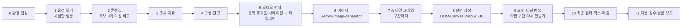

<div align="center">

# showreel (Antigravity / Gemini Edition)

**요청 한 번으로 한국어 모션그래픽 영상을 만드는 Google Antigravity (Gemini) 스킬 & 하네스입니다.<br/>콘셉트, 조사, 원고, 나레이션, 음악(합성·AI), 이미지(Gemini), 렌더, 비평과 재작업, 믹스, 검수까지 한 번에 진행합니다.**

[English](README.md) · [한국어](README.ko.md)

[](LICENSE)
[](https://antigravity.google/docs/skills)
[](#요구-사항)
[](https://www.python.org/)
[](https://nodejs.org/)


</div>

---

## 소개

`showreel (Antigravity / Gemini Edition)`은 [원작 `revfactory/showreel`](https://github.com/revfactory/showreel)을 **Google Antigravity (Gemini 모델)** 및 **Windows · macOS · Linux 크로스플랫폼 환경**에서 즉시 구동할 수 있도록 개조한 에이전트 스킬 및 프로젝트 하네스입니다.

"나를 소개하는 역동적인 한글 15초 모션그래픽 쇼릴 만들어줘", "신제품 출시 홍보 영상 30초, 웅장하게 만들어줘"처럼 짧게 요청하면 바로 납품할 수 있는 영상과 부속 파일을 만듭니다.

- **마스터 MP4**와 메신저/SNS용 **공유용 경량 MP4**
- **포스터 JPG**와 **자막 SRT**
- **제작노트 (`제작노트.md`)**: 콘셉트 비교, 설정값, 모든 파일을 다시 만드는 명령

### Antigravity (Gemini) 에디션의 주요 개선점
1. **API 키 없이도 100% 완주 가능 (수업·실습 최적화)**
   - 유료 API 키(ElevenLabs, OpenAI Codex 등)가 없어도 **내장 NumPy 신디사이저(`synth_music.py`)**로 영화 같은 배경음악과 23종의 효과음을 자체 합성하고, **Antigravity 내장 Gemini 이미지 생성기(`image-generator` 서브에이전트)**로 이미지를 생성하여 고품질 모션그래픽 MP4 영상을 완성합니다.
2. **Windows · macOS · Linux 완벽 호환**
   - Windows 환경의 한글 UTF-8 인코딩, 시스템 Chrome/Edge 자동 탐색, Windows 폰트 경로, FFmpeg 경로 구분자 처리를 완벽히 패치했습니다.
3. **워크스페이스 즉시 실행(`GEMINI.md`) 및 전역 스킬(`SKILL.md`) 동시 지원**
   - 이 저장소를 클론해서 Antigravity에서 폴더를 열기만 해도 `GEMINI.md`가 자동 활성화되어 바로 영상을 만들 수 있습니다.

---

## 작업 순서



오디오를 화면보다 먼저 만듭니다. `timeline.py`가 나레이션 단어 시각과 음악 히트를 이름 붙은 큐로 바꾸고, 장면 코드는 초 단위 숫자 대신 `REEL.cue('이름')`으로 그 큐를 읽습니다.

---

## 요구 사항

| 도구 | 필수 여부 | 용도 | 설치 방법 (Windows / macOS) |
| --- | --- | --- | --- |
| **Google Antigravity** | 필수 | Gemini 에이전트 실행 | Antigravity 2.0 데스크톱 앱 또는 IDE |
| **Node.js 20+** | 필수 | 렌더러(`playwright-core`) | Win: `winget install OpenJS.NodeJS.LTS` / Mac: `brew install node` |
| **FFmpeg** | 필수 | 인코딩, 음량 마스터링, 검수 | Win: `winget install Gyan.FFmpeg` / Mac: `brew install ffmpeg` |
| **Python 3.10+**, `numpy`, `Pillow` | 필수 | 타임라인, 합성 음악, 믹스, 검수 | `pip install numpy pillow` |
| **Google Chrome** (또는 Edge/Chromium) | 필수 | 헤드리스 프레임 캡처 | 시스템에 설치된 Chrome/Edge 자동 인식 |
| **ElevenLabs API 키** | 선택 | 한국어 나레이션(TTS) 및 AI 음악 | 없어도 `synth_music.py` 자체 합성 음악과 타이포그래피로 제작 가능 |

---

## 설치 및 시작하기 (수업·실습 가이드)

### 방법 A. 이 저장소를 그대로 워크스페이스로 열기 (가장 간편 · 수업 권장)

```bash
git clone https://github.com/AI-in-2hour/showreel.git
cd showreel
python -m pip install numpy pillow
cd scripts && npm install && cd ..
```

1. **Antigravity**에서 방금 클론한 `showreel` 폴더를 프로젝트(Workspace)로 엽니다.
2. 모델로 **Gemini**를 선택하고 채팅창에 원하는 영상을 요청합니다.

### 방법 B. 모든 프로젝트에서 쓰는 전역 스킬로 설치하기

```bash
# macOS / Linux
git clone https://github.com/AI-in-2hour/showreel.git ~/.gemini/config/skills/showreel
cd ~/.gemini/config/skills/showreel/scripts && npm install

# Windows (PowerShell)
git clone https://github.com/AI-in-2hour/showreel.git "$HOME\.gemini\config\skills\showreel"
cd "$HOME\.gemini\config\skills\showreel\scripts"; npm install
```

### 환경 점검 실행해 보기

```bash
python scripts/preflight.py
```

### 프롬프트 예시

채팅창에 아래와 같이 입력해 보세요:

```text
당신이 얼마나 놀라운 모션 그래픽 디자이너인지 보여주는 역동적인 한글버전 15초 모션그래픽 비디오를 만들어 보세요. 이력서용 쇼릴처럼요. 전력을 다해요.
```

```text
신제품 티저 30초 모션그래픽 영상 만들어 줘. 테크 키노트 느낌으로, 나레이션 없이 음악과 역동적인 한글 타이포그래피로 구성해 줘.
```

```text
우리 팀이 만든 AI 교육 과정 홍보 30초 모션그래픽 영상 만들어 줘. 강렬한 시작과 커리큘럼 하이라이트, 마지막에 신청 안내 엔드카드를 넣어 줘.
```

---

## 완성된 프로젝트 폴더 구조

```text
my-promo/
├── concept.md, storyboard.md, script.json, timeline.json
├── research/        research.md(출처가 달린 사실), photos.md
├── audio/           vo/(나레이션), music/(합성/AI 음악), sfx/(효과음), mix.wav
├── assets/          gen/(Gemini 생성 이미지), img/(후처리 이미지)
├── reel/            index.html, engine.js, fx.js, timeline.js, scenes.js, fonts/
├── qa/              스틸, 콘택트 시트, critique_NN.md, qa_report.md
├── out/             <제목>.mp4, <제목>_공유용.mp4, <제목>_포스터.jpg, .srt
└── 제작노트.md
```

---

## 스크립트 목록

| 스크립트 | 하는 일 |
| --- | --- |
| `preflight.py` | 도구, 브라우저, 폰트, 오디오/이미지 경로를 점검하고 설치 방법을 출력합니다 |
| `new_project.py` | 프로젝트 폴더, 엔진 템플릿, 한글 웹폰트(Pretendard·Google Fonts), 렌더러 의존성을 준비합니다 |
| `synth_music.py` | API 키 없이 NumPy만으로 고품질 배경음악(4가지 무드)과 효과음 23종을 합성합니다 |
| `music_tools.py` | 음악 템포·다운비트·강한 히트를 분석하고(`analyze`), 구간을 이어 붙이거나(`splice`) 길이를 맞춥니다 |
| `narrate.py` | (선택) ElevenLabs API 키가 있을 때 `script.json`에서 나레이션을 만들고 STT로 발음을 검증합니다 |
| `eleven.py` | (선택) ElevenLabs 클라이언트(TTS, STT, Music, 효과음, 보이스 목록) |
| `timeline.py` | `timeline.json`과 `reel/timeline.js`(큐, 단어 시각, 음량 곡선)를 만들고 겹침과 큐 누락을 검사합니다 |
| `prep_images.py` | 레터박스 제거, 확대, 블러본, 확인용 시트 생성 |
| `render.mjs` | 결정적 프레임 렌더러: 스틸, 초안, 모션 블러(`--sub 4`)를 넣은 최종본, 실시간 미리보기 서버(`--serve`) |
| `contact_sheet.py` | 스틸이나 영상으로 검수 시트를 만듭니다. 컷 앞뒤 프레임(`--around`)도 볼 수 있습니다 |
| `motion_check.py` | 길이별 기준으로 멈춘 구간, 움직임 부족 구간, 광과민성 섬광을 검사합니다 |
| `mix.py` | 나레이션·음악·효과음 덕킹 및 -14 LUFS / -2.0 dBTP 음량 마스터링을 수행합니다 |
| `finish.py` | 영상과 오디오를 합치고 공유용 MP4, 포스터 JPG, SRT 자막을 만들고 규격을 검증합니다 |
| `qa_check.py` | 완성본을 자동 검수하고 `qa/qa_report.md`와 최종 콘택트 시트를 작성합니다 |

---

## 라이선스 및 감사의 말

- [MIT 라이선스](LICENSE)로 배포합니다.
- 원작 스킬 및 모션 엔진: [revfactory/showreel](https://github.com/revfactory/showreel) (by [@revfactory](https://github.com/revfactory))
- Antigravity / Gemini & Windows 크로스플랫폼 포팅: [AI-in-2hour](https://github.com/AI-in-2hour)
